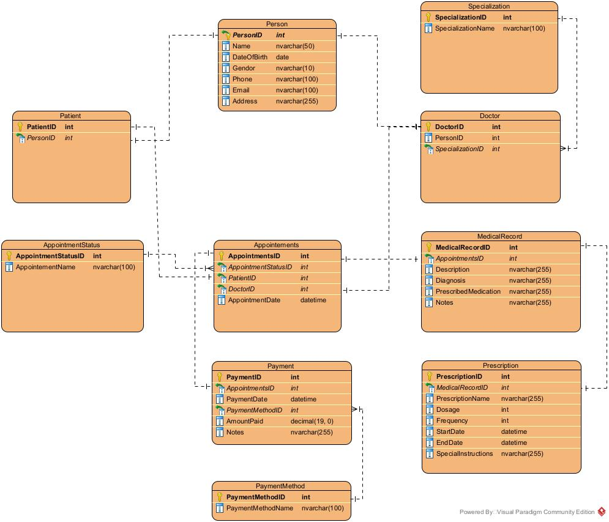

# 🏥 Clinic System API

A RESTful Web API for managing clinic operations, developed using ASP.NET Core Web API (.NET 8), Entity Framework Core 8, and SQL Server.

## Project Overview

The Clinic System API is designed to manage clinic-related data and operations, including patients, doctors, appointments, medical records, and payments.

The project follows a Three-Tier Architecture to separate responsibilities and improve code organization and maintainability.

## Technologies Used

- C#
- ASP.NET Core Web API (.NET 8)
- Entity Framework Core 8
- SQL Server Express
- Swagger / OpenAPI

## Features

- Manage patients and doctors.
- Manage appointments.
- Manage medical records.
- Manage payments.
- Expose API endpoints for interacting with clinic data.
- Use a layered architecture to separate business logic from data access and HTTP requests.

## Architecture

The project follows a Three-Tier Architecture:

- **Presentation Layer:** Handles HTTP requests through API controllers.
- **Business Layer:** Contains business logic and service classes.
- **Data Access Layer:** Handles database interactions using Entity Framework Core.

## Database

The project uses SQL Server Express with the Entity Framework Core Database First approach.

The database schema is created first, and the application code is designed to work with the existing database structure.

### Database Schema

## Project Status

**Version 1 — Initial Implementation**

This is the initial version of the project. Future updates will focus on improving code quality, implementing security features such as authentication and authorization, adding automated tests, and expanding the project's functionality.

## Database Setup

A database backup is available in the repository as `ClinicDB.bak`.

### Prerequisites

- SQL Server Express
- SQL Server Management Studio (SSMS)

### Restore the Database

1. Download `ClinicDB.bak` from the repository.
2. Open SQL Server Management Studio.
3. Connect to your SQL Server instance.
4. Right-click **Databases** and select **Restore Database**.
5. Select **Device** as the source and choose the downloaded backup file.
6. Complete the restore process.

### Connection String

Update the connection string in `appsettings.json` to match your SQL Server instance and database name.

## Running the Project

### Prerequisites

- Visual Studio 2022 with the .NET 8 SDK
- SQL Server Express
- SQL Server Management Studio (SSMS)

### Steps

1. Clone the repository from GitHub.
2. Restore the database using the provided `ClinicDB.bak` file.
3. Update the connection string in `appsettings.json` if necessary.
4. Open the solution file (`.sln`) in Visual Studio.
5. Set `Clinic-System` as the startup project.
6. Run the application and open Swagger to explore the API endpoints.

## Roadmap

- [ ] Improve code quality and error handling.
- [ ] Review and optimize database queries.
- [ ] Implement authentication and authorization.
- [ ] Add unit and integration tests.
- [ ] Improve project documentation and deployment instructions.
- [ ] Explore Docker and CI/CD integration.
